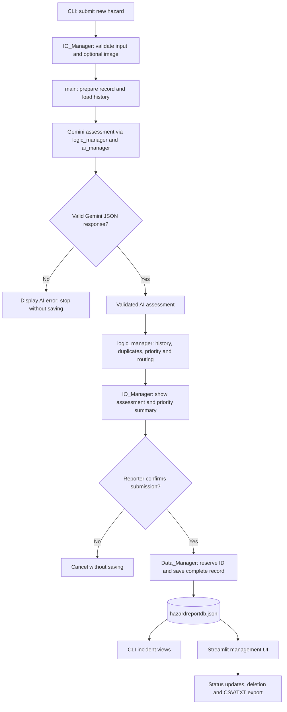

# 🛡️ Campus Safety Hazard Reporting System

**INF1103 · Team 4 · SIT Punggol Coast**

A modular Python campus hazard reporting application that lets students and staff submit facility hazards through a command-line interface (CLI). It requires a validated Google Gemini assessment before calculating risk priorities and saving a new incident, applies rule-based routing decisions, and stores completed records in a local JSON database. A separate Streamlit interface lets facilities staff review and manage incidents.

> **Project scope:** This is a prototype decision-support system. AI assessments and automated routing recommendations should be reviewed by authorised facilities personnel; the program does not itself dispatch an emergency response.

## 🎯 Project background and initial objectives

The **Team 4 Project Initial Details** proposal identified a campus-safety problem: students and staff need a centralised way to report hazards such as electrical faults, leaks, and damaged facilities, while maintenance teams need structured information to prioritise cases and recognise recurring problems. This prototype focuses on turning those reports into records that can be assessed, prioritised, and reviewed.

### 👥 Intended users

| User group | Intended use |
| --- | --- |
| **Front-line reporters (students and teachers)** | Report facility and equipment hazards encountered in classrooms, laboratories, lecture theatres, and other campus locations. |
| **Maintenance teams and safety officers** | Review incoming incidents, identify higher-priority and recurring problems, and manage resolution progress. |

### 📝 Information collected

The proposal specified five main inputs: **location**, **visual evidence**, **number of people affected**, **asset information**, and an **unstructured hazard description**. The implemented CLI also collects reporter name and contact details. Visual evidence is optional in the current application.

### 📌 Goals and implementation status

| Proposed capability | Current implementation |
| --- | --- |
| Multimodal hazard submission | CLI accepts written report details and one optional PNG, JPEG or WebP image through a graphical picker or terminal path input when the GUI is unavailable. |
| AI risk summary, classification and assessment | A valid Gemini assessment supplies the risk summary, category, severity, operational impact and contextual insights; unsuccessful assessments cannot be saved. |
| Historical patterns and duplicate detection | Rule-based comparisons identify prior incidents with matching location and asset details. |
| Deterministic priority and routing | Business rules calculate a score, recommend an action, and assign a queue label. |
| Human-in-the-loop oversight | Streamlit interface supports incident review and status changes; it does **not** currently offer an interface to edit AI category, severity, or routing recommendations. |
| Persist incident and dispatch | The system stores the incident and its recommended dispatch route locally; it does **not** automatically notify or dispatch a real maintenance or emergency team. |

**Design distinction:** A validated Gemini assessment is essential to submitting a new report. A failed AI request stops the workflow without scoring or saving; when AI succeeds, the reporter reviews the priority summary and confirms or cancels. Only successful, confirmed reports are saved to JSON. This safeguard applies to new submissions; historical records created before its implementation may contain offline fallback assessments.

## ✨ Features

- **📝 Guided hazard reporting:** Collects reporter details, location, estimated people affected, asset information, and a hazard description, with input validation.
- **📷 Optional image evidence:** Accepts PNG, JPEG and WebP images through a graphical file picker, with terminal-based path input when a graphical interface is unavailable. Images are saved in the `uploads/` directory using their original filenames. When a filename already exists, a numbered suffix (such as `_2` or `_3`) prevents overwriting.
- **🤖 AI risk assessment:** Requests a structured Gemini assessment containing category, severity, operational impact, risk summary, and contextual insights.
- **🛡️ AI-dependent submission (C2):** Every new report attempts Gemini processing. Only a successfully validated Gemini assessment can proceed to prioritisation and saving; API failures stop the submission safely without creating an incident.
- **🚦 Priority and routing:** Calculates a priority score, recommends an action, and assigns a maintenance or urgent-dispatch queue label.
- **🔎 Recurring-hazard checks:** Compares new reports with historical records to identify repeated location/asset combinations and potential duplicates.
- **🗃️ Incident history:** Saves each completed report, including the original inputs, assessment, decision, ID, timestamp, and status, in `hazardreportdb.json`.
- **🔢 Persistent incident IDs:** Reserves sequential incident identifiers using a private `.incident_id_counter` beside the database. Deleting or clearing records does not reset the ID sequence during normal single-writer operation.
- **🗂️ Database backup and recovery:** Saves a timestamped snapshot before deleting an incident or clearing a nonempty database. If backup creation fails, the destructive operation is cancelled. Retains up to 30 snapshots and supports programmatic restoration.
- **🖥️ Facilities management UI:** Provides a Streamlit dashboard for incident review, status updates, deletion, and CSV/TXT exports.
- **🔄 Automatic dashboard refresh:** A Streamlit fragment reloads incident records approximately every 2 seconds, allowing CLI submissions and management changes to appear without manually refreshing the page.
- **📄 Readable TXT reports:** The improved export generates separate, labelled sections for each incident instead of CSV-formatted text.

## 📁 Project structure

```text
.
├── main.py                       # CLI entry point and workflow orchestration
├── IO_Manager.py                 # Console menus, validation and image selection
├── ai_manager.py                 # Gemini requests, JSON parsing and validation
├── logic_manager.py              # Fallback, scoring, duplicates and routing
├── Data_Manager.py               # Incident storage, ID counter, backups and exports
├── management_ui.py              # Streamlit incident management dashboard
├── test_script.py                # 40 procedural offline automated tests
├── requirement.txt               # Python dependencies (singular filename)
├── Dockerfile                    # Python 3.12 container configuration
├── .dockerignore                 # Excludes secrets/data from Docker build context
├── DOCKER.md                     # Docker build, run and troubleshooting guide
├── .github/                      # GitHub Actions configuration
│   └── workflows/
│       └── ci.yml                # Automated Python and Docker CI pipeline
├── .gitignore                    # Git exclusions
└── README.md

Generated locally (keep private; ensure these are excluded from Git tracking):
├── .env                          # Private Gemini API key; never commit
├── hazardreportdb.json           # Local incident database
├── .incident_id_counter          # Persistent incident ID counter
├── backups/                      # Private JSON database snapshots
├── uploads/                      # Optional hazard image attachments
├── evidence/                     # Optional local Docker image inputs (keep private)
├── hazard_reports.csv            # Generated CSV export
└── hazard_reports.txt            # Generated TXT export
```

## 🔄 How the system works



The application processes a report in this order:

1. **Input:** `IO_Manager.py` gathers and validates reporter details and optional evidence.
2. **Assessment:** `main.py` invokes `logic_manager.process_record()`, which calls `ai_manager.py` for Gemini processing. If the result is unavailable or fails validation, the new submission stops before scoring or saving.
3. **Business rules:** `logic_manager.py` checks historical frequency and potential duplicates, calculates a priority score, and selects a recommended action and route.
4. **Confirmation:** `IO_Manager.py` presents the assessment and recommended action; the reporter chooses whether to save or cancel.
5. **Storage:** For confirmed submissions, `Data_Manager.py` reserves an `INCIDENT-001`-style identifier in `.incident_id_counter` and persists the complete incident in `hazardreportdb.json`. The counter prevents reuse of issued numbers during normal single-writer operation.
6. **Review:** The CLI displays reports and frequent hazards; `management_ui.py` supports facilities review and incident management.

## 🧩 Modules and responsibilities

| File | Responsibility |
| --- | --- |
| `main.py` | Coordinates input, checks the JSON database at startup, enforces validated Gemini assessment before saving (C2), runs business rules and launches Streamlit as a subprocess. |
| `IO_Manager.py` | Displays the four-option CLI menu, validates reporter input and image attachment confirmation (`y`/`yes`/`n`/`no`), and uses Tkinter for optional image selection with terminal fallback. |
| `ai_manager.py` | Builds the Gemini prompt, attaches supported image content, calls configured models, parses JSON, and validates expected response fields. |
| `logic_manager.py` | Invokes AI processing, manages internal failure responses, checks incident history, calculates scores, detects duplicates and recommends routing; an offline response does not permit a saved submission. |
| `Data_Manager.py` | Loads and saves the JSON database, persists the incident ID counter, updates/deletes/clears records with backup protection for destructive operations, restores snapshots programmatically, and exports CSV/TXT files. |
| `management_ui.py` | Shows a Streamlit incident table and details, uses `Data_Manager.load()` for incident data, enables status changes and deletion, and provides exports, with an approximately 2-second automatic refresh. |
| `test_script.py` | Runs 40 procedural offline automated tests, including mocked Gemini requests, C2 rejection of AI failures, incident ID persistence, backup recovery and input validation. |

## ✅ Prerequisites

- **Python 3.10 or newer** (the updated Streamlit dashboard uses union type annotations such as `list[dict[str, Any]] | None`).
- `pip` and access to install Python dependencies.
- **Docker Desktop / Docker Engine** for the optional container build and demonstration.
- A graphical environment with Tkinter for the native image picker; where unavailable, the CLI accepts an image file path instead.
- A **valid Gemini API key and working Gemini service are required to complete a new report submission**. If assessment fails, the application reports the error and does not save an incident.

## 🛠️ Installation

1. Clone the repository and enter the project directory:

   ```bash
   git clone https://github.com/2603229/INF1103_P3_T4.git
   cd INF1103_P3_T4
   ```

2. Install dependencies from the provided file:

   ```bash
   python -m pip install -r requirement.txt
   ```

3. Create a local `.env` file in the project root:

   ```dotenv
   GEMINI_API_KEY=replace_with_your_gemini_api_key
   ```

## ▶️ Running the application

Start the combined CLI + management UI using:

```bash
python main.py
```

The CLI offers four options:

| Option | Action |
| --- | --- |
| `1` | Submit New Hazard Report |
| `2` | View All Logged Incidents |
| `3` | View Top 5 Most Frequent Hazards |
| `4` | Exit |

`main.py` also starts Streamlit in a subprocess. To run **only** the facilities management dashboard, use:

```bash
python -m streamlit run management_ui.py
```

Streamlit is typically available locally at `http://localhost:8501`. When launched from `main.py`, its terminal output is suppressed, so open that address manually if necessary. The dashboard shows a message when the database is missing or empty and rechecks it automatically. Exiting the CLI shuts down the Streamlit subprocess in the updated `main.py`.

### 📋 Submitting a report

Choose option `1` and enter the requested reporter name, SIT email or Singapore phone number, location, estimated affected headcount, asset summary, and detailed description. Optionally attach a PNG, JPEG or WebP image: the CLI validates a yes/no confirmation and then opens a file picker or accepts a terminal path when a GUI is unavailable. The application assesses the report, checks historical records, determines priority and routing, and presents a pre-submission summary. It saves the complete report only after the reporter confirms.

The current input checks include:

- A reporter name using supported letters and punctuation.
- An `@sit.singaporetech.edu.sg` email or a validated eight-digit phone number.
- A nonempty location.
- An affected headcount from **1 to 1,000**.
- An asset summary of at least **3 characters**.
- A hazard description of at least **15 characters**.

## 🐳 Docker Deployment

The Campus Safety Hazard Reporting System includes Docker configuration for consistent deployment. The Docker image uses **Python 3.12**, installs dependencies from `requirement.txt`, and runs the interactive CLI (`main.py`) together with the Streamlit facilities dashboard on port **8501**.

### Prerequisites

Install Docker Desktop (Windows/macOS) or Docker Engine (Linux) and ensure the Docker service is running.

### Build the Docker image

From the project root:

```bash
docker build -t hazard-reporter .
```

### Run automated tests in Docker

Run the procedural offline tests inside the image:

```bash
docker run --rm hazard-reporter python test_script.py
```

**Verified Docker CI result (13 October 2026):** GitHub Actions [run #18](https://github.com/2603229/INF1103_P3_T4/actions/runs/38367739326), commit `4d6c114`, successfully built the Docker image and passed all 40 tests in both Python and Docker, with zero failures, errors or skips. The workflow also exported and uploaded the tested Docker image as a downloadable artifact.

### Recommended assessment demonstration

Use fictional test data and run the interactive CLI and dashboard with your private Gemini API key:

```powershell
docker build -t hazard-reporter .
docker run -it --rm --init --env-file .env -p 8501:8501 -v hazard-data:/app/data -v hazard-uploads:/app/uploads hazard-reporter
```

Submit a wet-floor hazard, display the **validated Gemini assessment**, priority and assigned queue, confirm and record the generated incident ID. Open `http://localhost:8501` to show the saved record, change its status and export CSV/TXT. Exit with CLI option `4` before running a second container on port 8501.

To demonstrate **C2 failure protection**, start an isolated container **without** the API key:

```powershell
docker run -it --rm --init -p 8501:8501 -v hazard-c2-demo:/app/data -v hazard-c2-uploads:/app/uploads hazard-reporter
```

Submit a valid fictional hazard. With no Gemini key supplied, the application should report that AI assessment is unavailable and **not save an incident**. The isolated `hazard-c2-demo` volume keeps this demonstration separate from normal report data.

### Run the CLI and dashboard

In **Windows PowerShell** (or a macOS/Linux terminal), from the project root with a private `.env` file:

```powershell
docker run -it --rm --init --env-file .env -p 8501:8501 -v hazard-data:/app/data -v hazard-uploads:/app/uploads hazard-reporter
```

The four-option CLI opens in the terminal. Visit **http://localhost:8501** to use the Streamlit dashboard. Select **option 4** in the CLI to exit. With no valid API key, the application still starts, but any new hazard submission stops safely without saving because C2 requires a valid Gemini assessment.

### Persistent data storage

The container uses named Docker volumes to preserve application data between container runs:

| Volume | Container directory | Stored content |
| --- | --- | --- |
| `hazard-data` | `/app/data` | `hazardreportdb.json`, `.incident_id_counter`, CSV/TXT exports and private `backups/` snapshots |
| `hazard-uploads` | `/app/uploads` | Attached hazard images |

Within Docker, `HAZARD_DATA_DIR=/app/data` ensures `Data_Manager.py` stores the database, `.incident_id_counter` and its `backups/` folder in the mounted volume. The database is created when the first confirmed incident is saved if it does not already exist. The counter and backups survive container restarts; **removing the `hazard-data` volume also removes the counter, database and backups**. Do not manually delete or reset the counter while retaining incident history.

### Optional image attachments

Docker runs without a graphical file picker, so the CLI accepts an image path instead. Place supported images in a local `evidence/` folder, mount the folder read-only when running the container, and enter the container path such as `/evidence/photo.jpg` when prompted. See [`DOCKER.md`](DOCKER.md) for the full Windows and macOS/Linux commands.

### Security

The `.dockerignore` file should keep the private `.env`, local incident database, `.incident_id_counter`, `backups/`, exports, uploaded images, local `evidence/` and Python caches out of the Docker build context. The `.gitignore` should separately exclude these private runtime files from Git tracking. **Verify that `.incident_id_counter` is listed in both ignore files** before committing.

Never publish real API keys, reporter contact details, or incident images. Keeping files out of future commits does not erase them from earlier Git history.

### Docker documentation and CI/CD status

See [`DOCKER.md`](DOCKER.md) for build/run commands, evidence mounting, volumes, shutdown and troubleshooting. Docker image building, automated testing, and persistence have been verified. GitHub Actions continuous integration is also configured and verified, as described below.

## 🔄 Continuous Integration (GitHub Actions)

The project uses GitHub Actions for **continuous integration (CI)**. The workflow is defined in [`.github/workflows/ci.yml`](.github/workflows/ci.yml) and runs on pushes, pull requests, and manual dispatch.

The GitHub Actions pipeline automatically verifies Python syntax, executes 40 tests, builds the Docker image, and repeats the tests inside Docker. On successful pushes to the main branch, the tested image is exported and uploaded as a downloadable artifact, supporting continuous delivery.

### CI pipeline

The pipeline runs on **Ubuntu 24.04** with **Python 3.12** and automatically:

1. Checks out the repository.
2. Sets up Python and installs dependencies from `requirement.txt`.
3. Verifies Python syntax.
4. Runs the current **40 offline automated tests**.
5. Builds the `hazard-reporter` Docker image.
6. Runs the same **40 tests again inside Docker**.
7. Exports the tested Docker image on successful pushes to `main`.
8. Uploads the Docker image as a downloadable GitHub Actions artifact.

Gemini API calls are mocked in the automated tests, so no live API key is required for CI.

### Verified workflow run

| Item | Verified result |
| --- | --- |
| Workflow | INF1103 Team 4 CI Pipeline |
| Run | **#18** |
| Date | **13 October 2026** |
| Branch | `main` |
| Commit | **`4d6c114`** |
| Status | **Success** |
| Python automated tests | **40/40 passed** |
| Docker automated tests | **40/40 passed** |
| Failures / errors / skipped | **0 / 0 / 0** |
| Build and syntax verification | **Passed** |

[View GitHub Actions runs](https://github.com/2603229/INF1103_P3_T4/actions).

GitHub Actions run #18 verified all 40 automated tests in Python and Docker, successfully built and exported the Docker image, and uploaded it as a downloadable artifact. This workflow supports continuous integration and delivery of tested Docker images, but does not automatically deploy the application to a production server.

## 🤖 AI assessment and C2 failure handling

The Gemini response is expected to contain these five string fields:

| Field | Expected content |
| --- | --- |
| `risk_summary` | Concise safety risk summary |
| `category` | `Electrical`, `Plumbing`, `Structural`, `HVAC`, or `IT/Equipment` |
| `severity` | `Low`, `Medium`, `High`, or `Critical` |
| `operational_impact` | `Minor`, `Moderate`, `Severe`, or `Catastrophic` |
| `contextual_insights` | Explanation and relevant safety considerations |

`ai_manager.py` uses the official Google GenAI SDK to request a structured JSON hazard assessment. The configured model candidates are `gemini-3.8-flash` and `gemini-3.6-flash`. A live request to `gemini-3.8-flash` succeeded during the Docker demonstration on 11 October 2026; availability of each model still depends on the configured API account.

Each HTTP request is configured with a **60-second timeout**. The application handles rate-limit errors (429), retries some temporary failures (such as 503), and switches between configured models where appropriate. The timeout applies **per HTTP request**, not to the entire assessment workflow; retries and model fallback can extend total processing time.

If Gemini is unavailable or returns an invalid assessment, `logic_manager.py` may generate provisional fallback values internally; however, **`main.py` rejects these results and does not calculate priority or save the new incident**. An attached image is not analysed by any offline fallback. A valid Gemini response is essential to completing a submission (C2), and any successful AI assessment still requires human verification.

## 🚦 Priority and incident management

The Logic Manager calculates priority using three factors: **severity**, **operational impact**, and **historical frequency**. Severity contributes 1 (Low), 2 (Medium), 4 (High), or 5 (Critical) points. Operational impact contributes 1 (Minor), 2 (Moderate), 4 (Severe), or 5 (Catastrophic) points. Historical frequency adds 0–3 points based on matching incidents at the same location and asset that have a **Resolved** or **Closed** status; unresolved incidents are checked separately for potential duplicates.

The total score and business rules determine **Normal**, **High**, or **Critical** priority, along with a recommended action. The `route(record)` function assigns the appropriate maintenance or urgent-dispatch **queue label** based on the evaluated priority; it does not dispatch personnel. Duplicate detection flags matching unresolved incidents. `Resolved` and `Closed` reports are excluded from active duplicate checks but still count toward historical frequency.

Each saved record includes an incident identifier, timestamp, reporter input, assessment source, assessment fields, duplicate/frequency information, score, recommended action, assigned route, and status. Data is stored in the local `hazardreportdb.json` file.

In the Streamlit dashboard, facilities staff can view incidents sorted by score, inspect assessment details and image evidence where available, change a status among **Pending Review**, **In Progress**, **Resolved**, and **Closed**, delete a record after confirmation, and export incident records to **CSV** or **readable TXT**. A deletion creates a complete database backup first; the incident is not removed if backup creation fails. The dashboard uses `@st.fragment(run_every="2s")` to reload data periodically. Status updates and deletions trigger an immediate fragment rerun. Generated downloads are retained in Streamlit session state so the download buttons remain available across automatic refreshes.

### Database backup and recovery

`Data_Manager.delete_incident_by_id()` creates a timestamped `incidents_backup_*.json` snapshot **before** deleting an existing incident. `Data_Manager.clear_database()` likewise backs up the database before clearing **nonempty** incident records. If backup creation fails, the deletion or clearing is cancelled, keeping the current database intact. A maximum of **30 snapshots** is retained in the private `backups/` folder beside the database. Backups can include reporter details and must not be committed or shared.

`Data_Manager.list_backups()` lists stored snapshots, while `Data_Manager.restore_backup()` supports database recovery.
The Streamlit dashboard provides a "Restore from backup" section that allows facilities personnel to restore the newest available
backup after confirming the operation. The system creates a safety backup of the current database before restoration, if one exists.

Older snapshots can be restored programmatically by specifying
their file paths. Automatic hourly backups are not scheduled.

`Data_Manager.py` also stores the last issued ID in `.incident_id_counter` beside the database. This file is not reset by incident deletion or clearing, so new records do not reuse IDs during normal single-writer operation. The counter is not part of the JSON incident snapshots; retain it when managing or restoring backups. The new tests cover ID non-reuse, clearing protection and restoration.

## ⚙️ Configuration and data files

| Setting | Purpose |
| --- | --- |
| `GEMINI_API_KEY` | API key used by `ai_manager.py` for Gemini requests. |
| `INCIDENTS_DB` | Optional override for the JSON database location used by `Data_Manager.py` and the Streamlit UI. |
| `HAZARD_DATA_DIR` | Optional data directory for `Data_Manager.py` when `INCIDENTS_DB` is not set. |

**Database management:** Incident database reads and writes are centralised in `Data_Manager.py`. Both the main CLI and Streamlit management dashboard retrieve incidents through Data Manager. By default, records are stored in `hazardreportdb.json`, with `.incident_id_counter` and `backups/` in the same directory. The `INCIDENTS_DB` and `HAZARD_DATA_DIR` environment variables allow alternate storage paths.

## 🧪 Automated Testing

The project includes `test_script.py`, containing **40 procedural offline automated tests** without class definitions.

| Test area | Tests | What is covered |
| --- | ---: | --- |
| AI Manager | 14 | Prompt creation, response validation, JSON parsing, and mocked API requests |
| Logic Manager | 10 | Priority scoring, evaluation, historical-frequency filtering, duplicate detection, and fallback behaviour |
| Data Manager | 9 | Database load/save, sequential and non-reused IDs, status updates, pre-deletion and pre-clear backups, failure protection, restoration, and malformed JSON handling |
| IO Manager | 4 | Submission confirmation and image attachment confirmation input validation |
| Main Workflow | 3 | Saving valid confirmed reports, cancelling submissions and rejecting failed Gemini assessments (C2) |
| **Total** | **40** | **All 40 tests passed in Python CI and Docker CI on 12 October 2026** |

Run from the project root:

```bash
python test_script.py
```

For individual test results, or to run without database tests:

```bash
python test_script.py --details
python test_script.py --no-data
```

**Latest verified GitHub Actions run (13 October 2026, run #18, commit `4d6c114`):** All 40 tests passed in both Python and Docker (AI: 14; Logic: 10; Data: 9; IO: 4; Main: 3), with zero failures, errors or skips. The Docker image was successfully built, exported and uploaded as a downloadable artifact. Tests also verify AI failure protection (C2), incident ID persistence, backup recovery and input validation.

Gemini requests are mocked, so the automated tests do **not** require a live API key or network access. Database tests use temporary, isolated JSON storage. The CI checks do not prove the quality of real-world hazard classifications or the complete interactive Streamlit experience; those require a separate demonstration. For the C2 demonstration, start a test-only Docker container without `--env-file .env`, submit a sample hazard and verify that the application reports an AI error and creates no record.

## 👥 Created By

🎓 **INF1103 – Programming Fundamentals with DevOps**  
🏫 **Team 4 | Singapore Institute of Technology (SIT)**

### 👨‍💻 Team Members

- CHAN RUI RU
- CHEE BO YU
- KOH KA-WEI DARRYL
- CHUA QIN NI JAMIE
- KHUN AUNG HEIN
- CHIA SENG CHAN

## 🔗 Repository

[INF1103 Team 4 – GitHub](https://github.com/2603229/INF1103_P3_T4)